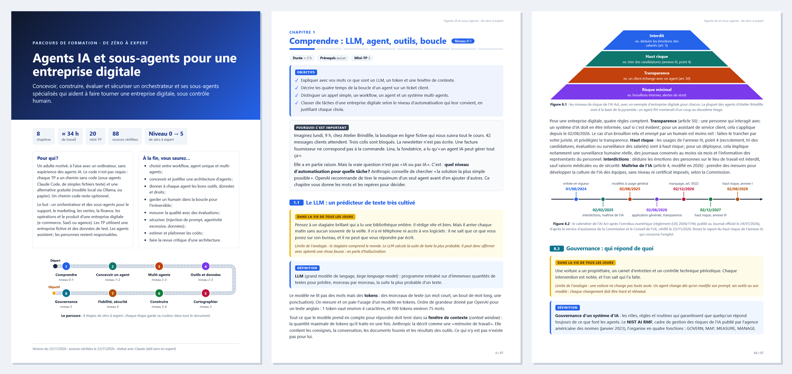
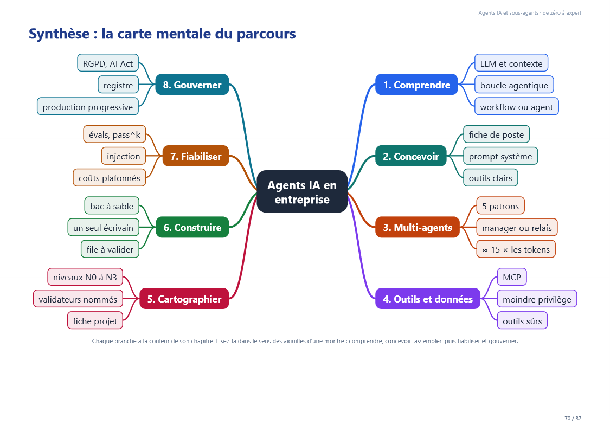

<div align="center">

# Zero to Expert

**Turn Claude into an expert teacher that researches, writes and verifies a complete course on any subject, delivered as a diagram-rich PDF.**

[](https://github.com/seccyber-si/zero-to-expert/releases/latest)
[](LICENSE)
[](#install)
[](#c-claudeai-or-claude-desktop-skill-only)

**English** · [Français](README.fr.md) · [Changelog](CHANGELOG.md)

</div>

<p align="center">
  
</p>

Zero to Expert is a **Claude skill** and **three Claude Code agents**. Name a subject and Claude works as two people at once: a seasoned practitioner of the field and an outstanding university teacher. It studies the domain, designs a progressive syllabus, finds and opens official sources, then writes a **complete zero-to-expert course as a print-ready PDF**: plain-language explanations, everyday analogies, diagrams, hands-on mini-labs, quizzes and mind maps.

```text
/zero-to-expert Kubernetes, short format
```

## Contents

- [Highlights](#highlights)
- [How it works](#how-it-works)
- [What a course contains](#what-a-course-contains)
- [Example courses](#example-courses)
- [Install](#install)
- [Usage](#usage)
- [Requirements](#requirements)
- [Customize](#customize)
- [Testing and known limits](#testing-and-known-limits)
- [Repository layout](#repository-layout)
- [Releasing](#releasing)
- [License](#license)

## Highlights

| | |
|---|---|
| **Expert first, teacher second** | Before writing, it builds an *expert brief*: the trade's standards, bodies, vocabulary, classic mistakes and professional reflexes. That brief gives the course its voice. |
| **Sources it actually opened** | Official PDFs, reference sites, university courses and YouTube videos. Every link is opened and checked for title, date, length and level. A source is never invented, and every one is listed with its verification date. |
| **One teaching path per notion** | Everyday analogy (with its limit) → one-sentence definition → diagram → concrete example → the expert's view → the common mistake. |
| **Hands-on from chapter 1** | 5 to 30-minute mini-labs, safe by design, with an expected result and an "if you're stuck" section. |
| **Diagrams drawn from plain lists** | Mind map, roadmap, process, cycle, layers/pyramid and timeline. Each chapter keeps its colour from the cover roadmap to the final global mind map. |
| **Independent review before delivery** | A separate reviewer agent reads the finished course like an auditor would. Its findings are fixed before you get the PDF. |

## How it works

```mermaid
flowchart LR
    A["Subject<br/>+ format"] --> B["1 · Become the expert<br/>expert brief"]
    B --> C["2 · Design the syllabus<br/>levels 0→5, objectives"]
    C --> D["3 · Find & verify sources<br/>parallel source agents"]
    D --> E["4 · Write the chapters<br/>analogies, diagrams, mini-labs"]
    E --> F["5 · Render the PDF<br/>Chromium print"]
    F --> G["6 · Check every page<br/>links, layout, previews"]
    G --> H["7 · Independent review<br/>reviewer agent, then fixes"]
    H --> I["Course PDF<br/>+ editable source folder"]
```



| Component | Role |
|---|---|
| `skills/zero-to-expert` | The 7-step method, teaching and sourcing rules, HTML template, stylesheet, diagram engine and helper scripts. Works on its own in claude.ai, Claude Desktop and Claude Code. |
| `zero-to-expert-teacher` agent | Builds a whole course autonomously, in the background, and returns the PDF path. |
| `zero-to-expert-sources` agent | Researches and verifies the sources of one chapter. Several run in parallel. |
| `zero-to-expert-reviewer` agent | Reviews the finished course independently before delivery. |

## What a course contains

| Part | Content |
|---|---|
| Cover | Title, key figures, audience, target skills and a visual roadmap of the whole path |
| How to use | Legend of the boxes and an automatic table of contents |
| Every chapter | Progress bar, objectives, "why it matters", notions (analogy, definition, diagram, example, expert's view, common mistake, tip), mini-labs, key takeaways, self-assessment, verified resources and a chapter mind map |
| End matter | Global mind map on a landscape page, a study plan with spaced repetition, a final project, certifications and communities, glossary, answer keys and an index of every source with its verification date |

Three sizes: **short** (3 chapters, compact layout, about 15–20 pages), **standard** (6–8 chapters, about 50–90 pages, the default) and **complete** (9–12 chapters). The course is written in the language of your request.

<p align="center">
  
</p>

## Example courses

Two real courses built by the kit during testing, in French, are attached to the [latest release](https://github.com/seccyber-si/zero-to-expert/releases/latest):

| Course | Format | Pages | Figures | Mini-labs | Verified sources |
|---|---|---|---|---|---|
| [AI agents and sub-agents for a digital business](https://github.com/seccyber-si/zero-to-expert/releases/latest/download/example-ai-agents-course-fr.pdf) | standard, 8 chapters | 87 | 29 | 20 | 88 |
| [ISO/IEC 27001 from zero to expert](https://github.com/seccyber-si/zero-to-expert/releases/latest/download/example-iso27001-course-fr.pdf) | short, 3 chapters | 17 | 13 | 4 | 27 |

## Install

### A. Claude Code plugin (recommended)

In a Claude Code session:

```text
/plugin marketplace add seccyber-si/zero-to-expert
/plugin install zero-to-expert@zero-to-expert-pack
```

As a plugin, names are prefixed: `/zero-to-expert:zero-to-expert` and the agent `zero-to-expert:zero-to-expert-teacher`.

### B. Claude Code, by copy

Download [`zero-to-expert-pack.zip`](https://github.com/seccyber-si/zero-to-expert/releases/latest/download/zero-to-expert-pack.zip) (or clone the repository), then from the `zero-to-expert-pack` folder:

```powershell
# Windows
powershell -ExecutionPolicy Bypass -File .\install.ps1
```

```bash
# macOS / Linux
bash install.sh
```

The skill goes to `~/.claude/skills/zero-to-expert/` and the agents to `~/.claude/agents/`.

| Option (PowerShell / bash) | Effect |
|---|---|
| `-Project <dir>` / `--project <dir>` | Install for one project only (`<dir>/.claude`) |
| `-Force` / `--force` | Replace an existing install |
| `-Uninstall` / `--uninstall` | Remove the kit |

Nothing is ever deleted: a previous copy is moved to `~/.claude/zero-to-expert-backups/<timestamp>/`. Open a new Claude Code session if the agents do not appear.

### C. claude.ai or Claude Desktop (skill only)

Download [`zero-to-expert-skill.zip`](https://github.com/seccyber-si/zero-to-expert/releases/latest/download/zero-to-expert-skill.zip) and upload it in the **Skills** section of Settings (skills must be enabled for your account). Agents exist only in Claude Code, so on claude.ai Claude does the research and the review itself. Without a Chromium browser in the environment, the course is delivered as HTML: open it in a browser and print to PDF.

## Usage

```text
/zero-to-expert digital photography
```

Or in plain language:

- "Build me a zero-to-expert course on Kubernetes, short format."
- "I'm a sysadmin preparing for ISO 27001: make me a complete course applied to my job."
- "Use the zero-to-expert-teacher agent to prepare a course on accounting while I work." The agent runs in the background and returns the PDF path.

Defaults: the language of your message, the standard size, and output on your Desktop: the PDF plus a `<subject>-source` folder so you can edit and rebuild the course later.

## Requirements

- **Web access** (search and fetch) for the sources.
- **A Chromium-based browser** to print the PDF: Edge (built into Windows), Chrome, Brave or Chromium.
- **For the scripts:** Windows PowerShell 5.1+ (built into Windows), or bash and curl on macOS/Linux.
- **Optional:** the Claude in Chrome extension, for YouTube and dynamic sites.

## Customize

| What | Where |
|---|---|
| Colours | `PALETTE` at the top of `skills/zero-to-expert/assets/diagrams.js` |
| Fonts, margins, callout boxes | `skills/zero-to-expert/assets/course.css` (`<body class="compact">` gives the denser short-format layout) |
| Teaching method | `skills/zero-to-expert/references/pedagogy.md` |
| Sourcing rules | `skills/zero-to-expert/references/sources.md` |
| Final quality gate | `skills/zero-to-expert/references/quality-checklist.md` |

## Testing and known limits

**Tested on 23/11/2026** on Windows 11 with Edge 158, Windows PowerShell 5.1 and Claude Code 2.1.302:

- **Building blocks:** PDF generation, the six diagram types, landscape pages, page-preview contact sheets, French typography, phrase search inside source PDFs (Windows OCR), link checking, YouTube search and plugin validation.
- **End-to-end, short format:** the teacher agent alone produced a 16-page ISO/IEC 27001 course (13 diagrams, 4 mini-labs, 27 sources opened and verified) in 56 minutes. The reviewer agent then found no blocking issue but 3 substantive errors an auditor would have caught, including a wrong answer key. All were fixed.
- **End-to-end, standard format:** an 87-page course on AI agents (8 chapters, 20 mini-labs, 29 figures, 88 sources), with four source agents in parallel. The reviewer found 4 major errors, two of them on lab sandbox safety. All were fixed.
- **Defects found by testing and fixed in v1.1.1:** a source agent deleted two unrelated temporary files through a wildcard cleanup (agents now delete only what they created, by exact path), and scripts resolved relative paths from PowerShell's start folder instead of the current folder.

**Limits:**

- **The `.sh` scripts (macOS/Linux) have not been tested yet.**
- **Time:** about 1 h 20 per course in both tests, review and fixes included. A complete-size course takes longer.
- **Protected sites:** some official sites refuse automated visits (403, "are you human" pages). The teacher never bypasses them: it looks for the same text elsewhere (PDF version, another official site, a free preview of a standard, an archived copy) or drops the source.
- **YouTube:** browser-less search reads public pages and can break if YouTube changes its format. The teacher then falls back to a browser or the web page.
- **Human review:** read the course before you share it, especially on regulated subjects (health, law, finance, security).

## Repository layout

```text
zero-to-expert/
├── README.md / README.fr.md         this page (English / French)
├── CHANGELOG.md                     release notes
├── LICENSE                          MIT
├── CITATION.cff                     how to cite the project
├── CONTRIBUTING.md                  how to report bugs and propose changes
├── CODE_OF_CONDUCT.md / SECURITY.md community rules / private security reports
├── install.ps1 / install.sh         install by copy (Windows / macOS-Linux)
├── tools/make-release.ps1           builds the release zips (maintainers)
├── docs/images/                     screenshots of the example courses
├── .github/                         issue and pull request templates
├── .claude-plugin/
│   ├── plugin.json                  the repository is a Claude Code plugin...
│   └── marketplace.json             ...and its own marketplace
├── agents/
│   ├── zero-to-expert-teacher.md    autonomous teacher (builds a whole course)
│   ├── zero-to-expert-sources.md    source researcher (one chapter, in parallel)
│   └── zero-to-expert-reviewer.md   independent reviewer (before delivery)
└── skills/zero-to-expert/
    ├── SKILL.md                     the 7-step method
    ├── references/                  pedagogy, sources, diagrams, quality checklist
    ├── assets/                      HTML template, stylesheet, diagram engine
    └── scripts/                     PDF, page previews, PDF text, links, YouTube
```

## Releasing

1. Set the same version in `.claude-plugin/plugin.json`, `.claude-plugin/marketplace.json` and `CITATION.cff`, and add an entry to `CHANGELOG.md`.
2. Run `claude plugin validate .`
3. Build: `powershell -ExecutionPolicy Bypass -File tools\make-release.ps1`. It checks the version numbers and that every `.ps1` file is pure ASCII, then writes `zero-to-expert-skill.zip` and `dist/zero-to-expert-pack.zip`.
4. Publish a GitHub release `vX.Y.Z` with both zips attached. Their names never change, so the "latest release" download links above stay valid.

## Contributing

Bug reports, course-quality feedback and pull requests are welcome: see [CONTRIBUTING.md](CONTRIBUTING.md). Report security problems privately, as explained in [SECURITY.md](SECURITY.md).

## License

[MIT](LICENSE) © 2026 The Zero to Expert Authors. To cite the project, use [`CITATION.cff`](CITATION.cff) or GitHub's **Cite this repository** button.
